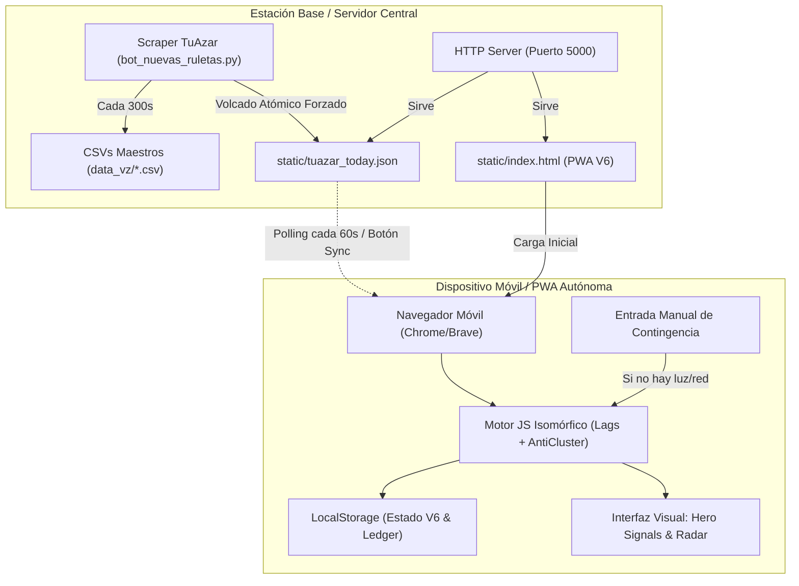

# MEMORIA TÉCNICA INSTITUCIONAL: REGISTRO DE ERRORES, ANÁLISIS DE FALLAS Y SOLUCIONES ARQUITECTÓNICAS PARA BOTS CUANTITATIVOS EN VIVO

---

## 1. Contexto Operativo
Durante la puesta en producción y operación en vivo del sistema de trading algorítmico multi-ruleta venezolano (portafolio de 7 a 9 ruletas activas con gestión de riesgo asimétrica a 30x y 60x), se identificaron fallas críticas en los canales de comunicación, persistencia de estados y visualización en tiempo real (PWA móvil).

Este documento compila el análisis forense, causa raíz y la solución probada para cada fallo, estableciendo el estándar de ingeniería para futuras implementaciones.

---

## 2. Matriz de Errores Críticos y Soluciones de Ingeniería

| ID | Subsistema Afectado | Síntoma Operativo | Causa Raíz Técnica | Solución Institucional Implementada |
| :--- | :--- | :--- | :--- | :--- |
| **ERR-01** | **Backend Móvil (Termux)** | El servidor local en Android dejaba de responder o se caía al apagar la pantalla. | Android Doze Mode y políticas de suspensión de procesos en segundo plano suspenden los sockets TCP y matan procesos de Python no registrados como servicio persistente. | **Arquitectura PWA 100% Autónoma:** Se desacopló el motor matemático de Python en el teléfono. Toda la lógica (lags, exclusión reciente, anti-clustering y balances) corre dentro del navegador web mediante LocalStorage e IndexedDB, eliminando la necesidad de Termux. |
| **ERR-02** | **Entorno de Red (OpenSSL / TLS)** | Falla al hacer scraping de TuAzar desde el móvil (`_ssl` corrupto / symbol `X509_STORE_get1_objects` faltante). | Incompatibilidad de compilación dinámica de OpenSSL en Python 3.14 dentro de Termux. | **Desacoplamiento de Ingesta:** La ingesta automatizada se delega a la estación base (PC o VPS) que compila un binario estático (`curl_static` musl) o un demonio Python robusto que expone un endpoint estático ligero (`tuazar_today.json`). |
| **ERR-03** | **Persistencia de Caché (Navegador Móvil)** | La interfaz PWA mostraba "Actualizado" o "Conectado", pero los datos correspondían a la jornada anterior. | Los navegadores modernos almacenan agresivamente en caché los archivos `.html` y las claves de `localStorage`, ignorando cambios en el servidor local sin cabeceras explícitas de invalidación. | **Versionado Estricto de Claves y Cache-Busting:** 1. Incorporación de parámetros de versión temporal (`?t=timestamp`) en cada llamada `fetch`. 2. Versionado secuencial de claves de base de datos local (`sniper_master_v4` $\to$ `v5` $\to$ `v6`) para forzar la purga y recarga del estado institucional. |
| **ERR-04** | **Filtro de Duplicados en Historial** | Al ingresar un sorteo matutino legítimo, la app lo descartaba y no recalculaba el radar. | La condición de descarte evaluaba: `h.hora === hora && h.numero === num`. Si en días previos a la misma hora había salido el mismo número, el sorteo de hoy era marcado erróneamente como ya existente. | **Unicidad Bidimensional Estricta:** La comprobación de duplicados debe evaluar obligatoriamente el par cronológico `(fecha, hora)`: `h.fecha === fecha && h.hora === hora`. |
| **ERR-05** | **Bucle de Ingesta Desconectado del Frontend** | El bot de Python descargaba los sorteos de TuAzar en RAM, pero el archivo estático consumido por la PWA no se actualizaba. | El script `bot_nuevas_ruletas.py` acumulaba los sorteos en diccionarios locales y CSVs de disco, pero carecía de una rutina atómica que volcara `data_today` hacia la carpeta `static/` servida por HTTP. | **Pipeline de Exportación Forzada en Cada Pasada:** Se integró un volcado atómico obligatorio dentro de `fetch_live_results()`: cada vez que el bot consulta TuAzar, escribe `tuazar_today.json` de forma atómica en la carpeta pública. |
| **ERR-06** | **Divergencia de Cálculo Matemático (Python vs JS)** | La app móvil calculaba disparos en ruletas que en el bot de la PC figuraban en espera o cuarentena. | El script JS intentaba recalcular series temporales desde cero omitiendo el reinicio diario de medianoche y los bloqueos por repetición contigua (`anti_clustering`). | **Motor Isomórfico Auditado:** Se transcribió con exactitud matemática la función de Python (`get_current_streaks`) a JavaScript (`calcularRachaYCandidatosInstitucional`), verificando coincidencia exacta de parámetros: `lags`, `rec_w`, `target_streaks`, `blacklist` y `anti_clustering`. |

---

## 3. Arquitectura Canónica para Futuros Bots

---

## 4. Protocolo Estándar de Despliegue para Nuevas Versiones
1. **Verificación de Ingesta:** Ejecutar `python bot_nuevas_ruletas.py --status` y comprobar que TuAzar entrega los sorteos del día sin excepciones.
2. **Generación Atómica de Artefactos Web:** Ejecutar el constructor maestro (`build_final.py`) para empaquetar el estado precomputado y el motor matemático en un solo archivo autosuficiente.
3. **Invalidación de Caché:** Siempre que se modifique la lógica o la estructura de datos, incrementar el identificador de almacenamiento (`_v(N+1)`) tanto en el cliente como en el backend.
4. **Respaldo de Continuidad:** Todo cálculo debe permitir entrada manual asistida (`Anotar Sorteo`) con liquidación en tiempo real ($<0.1\text{ s}$) para operar en condiciones de apagón o caída de telecomunicaciones.
