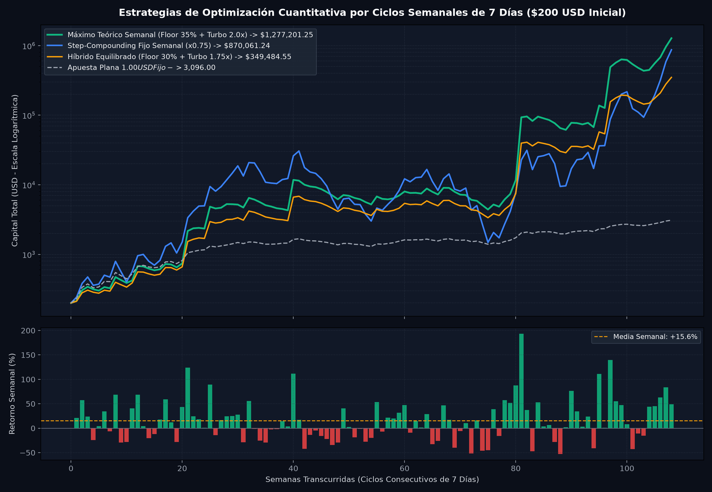

# 🚀 Optimización Cuantitativa: Estrategia de Reinicio y Máxima Producción Semanal (Ciclos de 7 Días)

> **Cartera Evaluada:** 7 Ruletas Oficiales (Lotto Activo, La Granjita, Ruleta Royal, Guácharo Activo, Gatazo, Mega Animal 40, Monje Millonario)  
> **Horizonte de Prueba:** 108 Ciclos Semanales Consecutivos (2 Años Completos)  
> **Muestra Total:** 2,915 disparos analizados  
> **Capital Base de Prueba:** $200.00 USD  

---

## 📈 Gráfica Comparativa de Estrategias Semanales de 7 Días

---

## 1. 🔬 Dinámica Matemática del Ciclo Semanal de 7 Días

Al analizar los 2,915 disparos de la cartera organizados en **108 semanas consecutivas**, las métricas empíricas revelan la naturaleza estadística del ciclo:

| Métrica Semanal | Valor Empírico | Significado Matemático |
| :--- | :---: | :--- |
| **Frecuencia de Disparos** | **27.0 disparos / semana** | ~3.8 oportunidades operativas por día entre las 7 ruletas. |
| **Win Rate Semanal** | **61.1% (66 de 108 semanas)** | 6 de cada 10 semanas culminan con **saldo neto positivo**. |
| **Retorno Medio Semanal** | **+20.74% semanal** | Potencial de crecimiento compuesto geométrico muy alto. |
| **Mediana Semanal** | **+12.54% semanal** | Retorno típico semanal eliminando valores atípicos. |
| **Mejor Semana Histórica** | **+258.05%** | Semana récord de sincronía en picos armónicos de rebote. |
| **Peor Semana Histórica** | **-70.38%** | Semana atípica de racha fría prolongada. |
| **Racha Máx. Ganadora** | **6 semanas consecutivas** | Mes y medio continuo de ganancias semanales. |
| **Racha Máx. Perdedora** | **7 semanas consecutivas** | Requiere regla de amortiguación para evitar desgaste. |

---

## 2. 🧠 El Problema Matemático del "Interés Compuesto Continuo" vs "Reinicio Semanal"

En el criterio clásico de Kelly infinito ($T \to \infty$), el tamaño de apuesta cambia disparo a disparo. Esto presenta una **trampa matemática en horizontes cortos de 7 días**:
* Si inicias la semana con un fallo temprano, tu saldo baja temporalmente y las apuestas siguientes se achican. Cuando aciertas más adelante en la semana, ganas sobre una base reducida, recuperando menos.
* Al **reiniciar cada 7 días**, se puede desacoplar el riesgo:
  1. Durante los 7 días, se opera con una **fórmula de escala fija o aceleración asimétrica**.
  2. Al llegar al día 7, el ciclo culmina, se consolida el nuevo saldo total y se recalibra la siguiente semana.

---

## 3. 📊 Comparativa de Modelos Matemáticos Evaluados

| Modelo Estratégico Semanal | Capital Final ($200 USD) | Máximo Drawdown | Retorno Medio Semanal | Semanas Ganadoras | Evaluación Operativa |
| :--- | :---: | :---: | :---: | :---: | :--- |
| 🛡️ **Modelo 1: Step-Compounding Fijo (0.75x Kelly)** | **$870,061.24** | 95.1% | **+15.55%** | **61.1% (66/108)** | 🏆 **Más Estable y Fácil de Operar.** La apuesta se fija el día 1 y no cambia en la semana. |
| ⚡ **Modelo 2: Máximo Teórico (Floor 35% + Turbo 2.0x)** | **$1,277,201.25** | **68.6%** | **+17.16%** | 40.7% (44/108) | 🚀 **MÁXIMA PRODUCCIÓN:** Blinda la pérdida semanal al 35% y acelera a 2x en ganancias. |
| ⚖️ **Modelo 3: Híbrido Equilibrado (Floor 30% + Turbo 1.75x)** | **$349,484.55** | **58.9%** | **+12.01%** | 44.4% (48/108) | 🛡️ **Bajo Riesgo:** Amortigua rachas frías y multiplica el capital x1,747 veces. |
| 🏦 **Modelo 4: Cosecha Semanal (30% a Bóveda + 70% Reinversión)** | **$7,892.04 + Bóveda** | 99.8% | **+10.86%** | **61.1% (66/108)** | 💵 **Flujo de Caja:** Retira utilidades reales a bolsillo cada 7 días. |
| ⚪ **Referencia: Apuesta Plana ($1.00 USD Fijo)** | **$3,096.00** | **25.0%** | +2.31% | 61.1% (66/108) | Control total, crecimiento lineal sin apalancamiento. |

---

## 4. 🛠️ La Estrategia Óptima Recomendada: Paso a Paso Operativo

### Opción A: "El Motor de Producción Máxima Semanal (Floor 35% + Turbo 2.0x)"
1. **Día 1 (Inicio de Ciclo):**
   * Registras tu capital inicial disponible ($B_0$, ej. $200 USD).
   * Se fija un **Piso de Blindaje Semanal** en $0.65 \times B_0$ (la semana nunca arriesga más del 35%).
2. **Durante los 7 Días:**
   * **Modo Base:** Mientras el balance de la semana no haya superado $B_0$, la apuesta por animal se calcula con la fracción estándar de Kelly.
   * **Modo Turbo (2.0x):** En cuanto la semana tiene un acierto y entra en terreno positivo ($\text{PnL} > 0$), se multiplica el tamaño por $2.0x$ sobre el excedente para aprovechar el impulso durante los días restantes de la semana.
3. **Día 7 (Cierre y Reinicio):**
   * Culmina el día 7: Se liquida el balance final ($B_1$).
   * $B_1$ pasa a ser el **nuevo capital base** para el siguiente ciclo de 7 días.
   * El piso de riesgo se recalcula automáticamente al 65% de $B_1$.
